<!-- omit from toc -->
# OpenShift Deployment
This guide will outline the necessary steps for deploying and running the RAG QuickStart on an OpenShift cluster.

<!-- omit from toc -->
## Table of Contents
- [Prerequisites](#prerequisites)
- [Supported Models](#supported-models)
- [Installing the RAG QuickStart](#installing-the-rag-quickstart)
  - [1. Clone Repository](#1-clone-repository)
  - [2. Login to OpenShift](#2-login-to-openshift)
  - [3. Hardware Configuration](#3-hardware-configuration)
  - [4. Navigate to Deployment Directory](#4-navigate-to-deployment-directory)
  - [5. List Available Models](#5-list-available-models)
  - [6. Initialize Configuration (Recommended for Fine-Grained Control)](#6-initialize-configuration-recommended-for-fine-grained-control)
  - [7. Deploy with Helm](#7-deploy-with-helm)
    - [Option A: Deploy with Configuration File (Recommended)](#option-a-deploy-with-configuration-file-recommended)
    - [Option B: Deploy with Command-Line Parameters](#option-b-deploy-with-command-line-parameters)
  - [8. Monitor Deployment](#8-monitor-deployment)
  - [9. Verify Installation](#9-verify-installation)
    - [Verify OpenShift AI Dashboard](#verify-openshift-ai-dashboard)
    - [Configure Kubeflow Pipelines (Optional - for Batch Document Ingestion)](#configure-kubeflow-pipelines-optional---for-batch-document-ingestion)
    - [Verify Embeddings in PGVector (Optional)](#verify-embeddings-in-pgvector-optional)
- [Using the RAG UI](#using-the-rag-ui)
- [Environment Variables](#environment-variables)
  - [RAG UI Environment Variables](#rag-ui-environment-variables)
  - [Llama Stack Environment Variables](#llama-stack-environment-variables)
  - [Configuring Environment Variables](#configuring-environment-variables)
- [Adding a new model](#adding-a-new-model)
- [Uninstalling the RAG QuickStart](#uninstalling-the-rag-quickstart)


## Prerequisites

- OpenShift Cluster 4.16+ with OpenShift AI
- OpenShift Client CLI - [oc](https://docs.redhat.com/en/documentation/openshift_container_platform/4.18/html/cli_tools/openshift-cli-oc#installing-openshift-cli)
- Helm CLI - helm
- [huggingface-cli](https://huggingface.co/docs/huggingface_hub/guides/cli) (optional)
- 1 GPU/HPU with 24GB of VRAM for the LLM, refer to the chart below
- 1 GPU/HPU with 24GB of VRAM for the safety/shield model (optional)
- [Hugging Face Token](https://huggingface.co/settings/tokens)
- Access to [Meta Llama](https://huggingface.co/meta-llama/Llama-3.2-3B-Instruct/) model.
- Access to [Meta Llama Guard](https://huggingface.co/meta-llama/Llama-Guard-3-8B/) model.
- Some of the example scripts use `jq` a JSON parsing utility which you can acquire via `brew install jq`

## Supported Models

| Function    | Model Name                             | Hardware    | AWS
|-------------|----------------------------------------|-------------|-------------
| Embedding   | `all-MiniLM-L6-v2`                     | CPU/GPU/HPU |
| Generation  | `meta-llama/Llama-3.2-3B-Instruct`     | L4/HPU      | g6.2xlarge
| Generation  | `meta-llama/Llama-3.1-8B-Instruct`     | L4/HPU      | g6.2xlarge
| Generation  | `meta-llama/Meta-Llama-3-70B-Instruct` | A100 x2/HPU | p4d.24xlarge
| Safety      | `meta-llama/Llama-Guard-3-8B`          | L4/HPU      | g6.2xlarge

Note: the 70B model is NOT required for initial testing of this example.  The safety/shield model `Llama-Guard-3-8B` is also optional. 

## Installing the RAG QuickStart

### 1. Clone Repository

Clone the repo so you have a working copy

```bash
git clone https://github.com/rh-ai-quickstart/RAG
```

### 2. Login to OpenShift

Login to your OpenShift Cluster

```bash
oc login --server="<cluster-api-endpoint>" --token="sha256~XYZ"
```

### 3. Hardware Configuration

Determine what hardware acceleration is available in your cluster and configure accordingly.

   **For NVIDIA GPU nodes**: If GPU nodes are tainted, find the taint key. In the example below the key for the taint is `nvidia.com/gpu`

   ```bash
   oc get nodes -l nvidia.com/gpu.present=true -o yaml | grep -A 3 taint 
   ```
   
   **For Intel Gaudi HPU nodes**: If HPU nodes are tainted, find the taint key. The taint key is typically `habana.ai/gaudi`

   ```bash
   oc get nodes -l habana.ai/gaudi.present=true -o yaml | grep -A 3 taint 
   ```
   
   The output of either command may be something like below:
   ```
   taints:
     - effect: NoSchedule
       key: nvidia.com/gpu  # or habana.ai/gaudi for HPU
       value: "true"
   ```

   You can work with your OpenShift cluster admin team to determine what labels and taints identify GPU-enabled or HPU-enabled worker nodes. It is also possible that all your worker nodes have accelerators therefore have no distinguishing taint.

### 4. Navigate to Deployment Directory

Navigate to Helm deploy directory

```bash
cd deploy/helm
```

### 5. List Available Models

List available models

```bash
make list-models
```

The above command will list the models to use in the next command

```bash
(Output)
model: llama-3-1-8b-instruct (meta-llama/Llama-3.1-8B-Instruct)
model: llama-3-2-1b-instruct (meta-llama/Llama-3.2-1B-Instruct)
model: llama-3-2-1b-instruct-quantized (RedHatAI/Llama-3.2-1B-Instruct-quantized.w8a8)
model: llama-3-2-3b-instruct (meta-llama/Llama-3.2-3B-Instruct)
model: llama-3-3-70b-instruct (meta-llama/Llama-3.3-70B-Instruct)
model: llama-guard-3-1b (meta-llama/Llama-Guard-3-1B)
model: llama-guard-3-8b (meta-llama/Llama-Guard-3-8B)
```

The "guard" models can be used to test shields for profanity, hate speech, violence, etc.

### 6. Initialize Configuration (Recommended for Fine-Grained Control)

You can configure your deployment in two ways:
1. **Using a configuration file** (recommended for complex setups, multiple models, or persistent configuration)
2. **Using command-line parameters** (quick deployments, see step 7 Option B)

To use the configuration file approach, initialize it. This will create a `rag-values.yaml` file from the example template:

```bash
make init-config
```

The system will display a configuration banner prompting you to edit the file. Open a new terminal window and edit the configuration:

```bash
# Edit with your preferred editor
nano rag-values.yaml
# or
vim rag-values.yaml
```

**Important**: You MUST configure at least:

1. **Enable at least ONE model** in the `global.models` section by setting `enabled: true`
2. **Add your Hugging Face token** (get it from https://huggingface.co/settings/tokens)
3. **(Optional)** Add your TAVILY API key for web search functionality
4. **(Optional)** Configure tolerations if your nodes are tainted (see step 3)

**Example model configuration:**
```yaml
global:
  models:
    llama-3-2-3b-instruct:
      id: meta-llama/Llama-3.2-3B-Instruct
      enabled: true
      device: "gpu"  # Options: "cpu", "gpu", "hpu"
      resources:
        limits:
          nvidia.com/gpu: "1"
      tolerations:
      - key: "nvidia.com/gpu"
        operator: Exists
        effect: NoSchedule
```

**Quick configuration commands:**
```bash
# Interactively configure API keys
make configure-keys

# View current configuration
make show-config

# Validate configuration
make validate-config
```

### 7. Deploy with Helm

There are two ways to deploy: using the configuration file or using command-line parameters.

#### Option A: Deploy with Configuration File (Recommended)

After configuring the `rag-values.yaml` file in step 6, deploy using make:

```bash
make install NAMESPACE=llama-stack-rag
```

The system will:
1. Validate your configuration
2. Prompt for any missing API keys (Hugging Face token, TAVILY key)
3. Deploy all configured services using the models and settings from `rag-values.yaml`

#### Option B: Deploy with Command-Line Parameters

You can also deploy by passing configuration parameters directly via the command line. This approach is useful for quick deployments or CI/CD pipelines.

**GPU Deployment Examples (Default):**

To install only the RAG example, no shields:

```bash
make install NAMESPACE=llama-stack-rag LLM=llama-3-2-3b-instruct LLM_TOLERATION="nvidia.com/gpu"
```

To install both the RAG example and the guard model for shields:

```bash
make install NAMESPACE=llama-stack-rag LLM=llama-3-2-3b-instruct LLM_TOLERATION="nvidia.com/gpu" SAFETY=llama-guard-3-8b SAFETY_TOLERATION="nvidia.com/gpu"
```

*Note: `DEVICE=gpu` is the default and can be omitted.*

**Intel Gaudi HPU Deployment Examples:**

To install only the RAG example on Intel Gaudi HPU nodes:

```bash
make install NAMESPACE=llama-stack-rag LLM=llama-3-2-3b-instruct LLM_TOLERATION="habana.ai/gaudi" DEVICE=hpu
```

To install both the RAG example and guard model on Intel Gaudi HPU nodes:

```bash
make install NAMESPACE=llama-stack-rag LLM=llama-3-2-3b-instruct LLM_TOLERATION="habana.ai/gaudi" SAFETY=llama-guard-3-8b SAFETY_TOLERATION="habana.ai/gaudi" DEVICE=hpu
```

**CPU Deployment Example:**

To install on CPU nodes only:

```bash
make install NAMESPACE=llama-stack-rag LLM=llama-3-2-3b-instruct DEVICE=cpu
```

**Simplified Commands (No Tolerations Needed):**

If you have no tainted nodes (all worker nodes have accelerators), you can use simplified commands:

```bash
# GPU deployment (default - DEVICE=gpu can be omitted)
make install NAMESPACE=llama-stack-rag LLM=llama-3-2-3b-instruct SAFETY=llama-guard-3-8b

# HPU deployment  
make install NAMESPACE=llama-stack-rag LLM=llama-3-2-3b-instruct SAFETY=llama-guard-3-8b DEVICE=hpu

# CPU deployment
make install NAMESPACE=llama-stack-rag LLM=llama-3-2-3b-instruct SAFETY=llama-guard-3-8b DEVICE=cpu
```

**Note**: When using command-line parameters, the `rag-values.yaml` file will still be created from the example template if it doesn't exist. Command-line parameters will override the model settings in the values file.

When prompted, enter your **[Hugging Face Token](https://huggingface.co/settings/tokens)**.

This process may take 10 to 30 minutes depending on the number and size of models to be downloaded.

### 8. Monitor Deployment

Watch/Monitor

```bash
oc get pods -n llama-stack-rag
```

```
(Output)
NAME                                                               READY   STATUS      RESTARTS   AGE
demo-rag-vector-db-v1-0-8mkf9                                      0/1     Completed   0          10m
ds-pipeline-dspa-7788689675-9489m                                  2/2     Running     0          10m
ds-pipeline-metadata-envoy-dspa-948676f89-8knw8                    2/2     Running     0          10m
ds-pipeline-metadata-grpc-dspa-7b4bf6c977-cb72m                    1/1     Running     0          10m
ds-pipeline-persistenceagent-dspa-ff9bdfc76-ngddb                  1/1     Running     0          10m
ds-pipeline-scheduledworkflow-dspa-7b64d87fd8-58d87                1/1     Running     0          10m
ds-pipeline-workflow-controller-dspa-5799548b68-bxpdp              1/1     Running     0          10m
fetch-and-store-pipeline-tmxwj-system-container-driver-287597120   0/2     Completed   0          3m43s
fetch-and-store-pipeline-tmxwj-system-container-driver-922184592   0/2     Completed   0          2m54s
fetch-and-store-pipeline-tmxwj-system-container-impl-3210250134    0/2     Completed   0          4m33s
fetch-and-store-pipeline-tmxwj-system-container-impl-3248801382    0/2     Completed   0          3m32s
fetch-and-store-pipeline-tmxwj-system-dag-driver-3443954210        0/2     Completed   0          4m6s
llama-3-2-3b-instruct-predictor-00001-deployment-6bbf96f8674677    3/3     Running     0          10m
llamastack-6d5c5b999b-5lffb                                        1/1     Running     0          11m
mariadb-dspa-74744d65bd-fdxjd                                      1/1     Running     0          10m
minio-0                                                            1/1     Running     0          10m
minio-dspa-7bb47d68b4-nvw7t                                        1/1     Running     0          10m
pgvector-0                                                         1/1     Running     0          10m
rag-7fd7b47844-nlfvr                                               1/1     Running     0          11m
rag-mcp-weather-9cc97d574-nf5q8                                    1/1     Running     0          11m
rag-pipeline-notebook-0                                            2/2     Running     0          10m
upload-sample-docs-job-f5k5w                                       0/1     Completed   0          10m
```

Verify deployment:

```bash
oc get pods -n llama-stack-rag
oc get svc -n llama-stack-rag
oc get routes -n llama-stack-rag
```

Note: The key pods to watch include **predictor** in their name, those are the kserve model servers running vLLM

```bash
oc get pods -l component=predictor
```

Look for **3/3** under the Ready column

The **inferenceservice** CR describes the limits, requests, model name, serving-runtime, chat-template, etc. 

```bash
oc get inferenceservice llama-3-2-3b-instruct \
  -n llama-stack-rag \
  -o jsonpath='{.spec.predictor.model}' | jq
```

### 9. Verify Installation

Watch the **llamastack** pod as that one becomes available after all the model servers are up.

```bash
oc get pods -l app.kubernetes.io/name=llamastack
```

#### Verify OpenShift AI Dashboard

Navigate to OpenShift AI Dashboard and verify the deployment:

1. Get the OpenShift AI Dashboard route:

```bash
oc get routes rhods-dashboard -n redhat-ods-applications
```

2. Login to the OpenShift AI Dashboard and find the `llama-stack-rag` project.

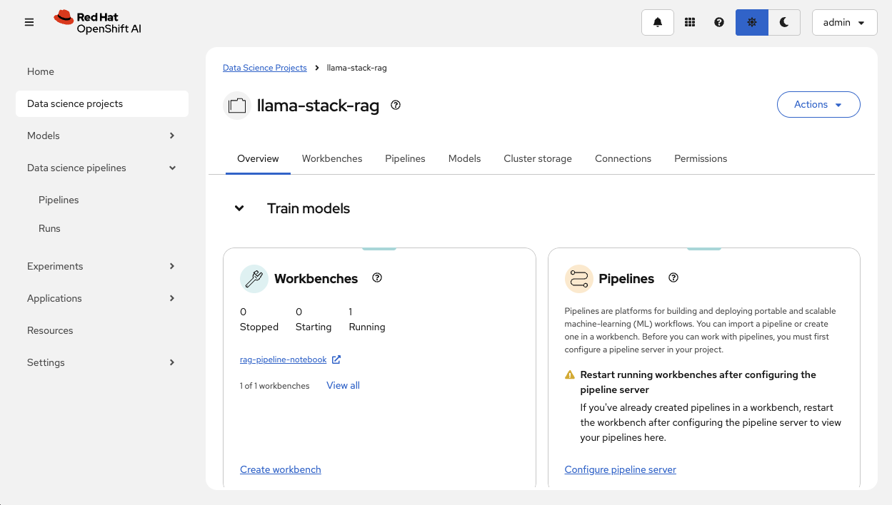

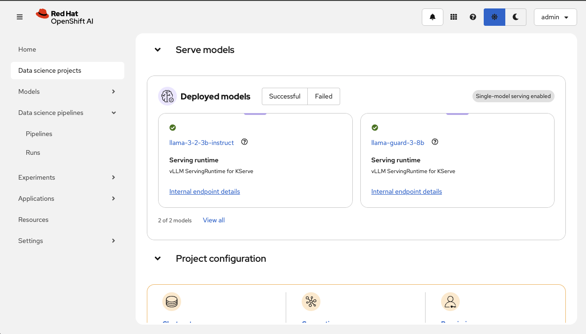

3. You should see a running workbench with Jupyter Notebook.

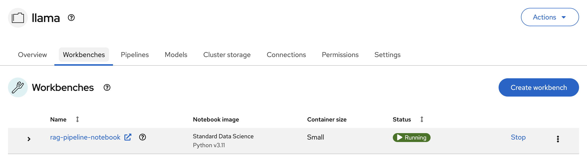

#### Configure Kubeflow Pipelines (Optional - for Batch Document Ingestion)

If you want to use the pre-ingestion pipeline for batch document processing, configure Kubeflow Pipelines with object storage:

[Reference Documentation](https://docs.redhat.com/en/documentation/red_hat_openshift_ai_self-managed/2.8/html/working_on_data_science_projects/working-with-data-science-pipelines_ds-pipelines#configuring-a-pipeline-server_ds-pipelines)

The `configure-pipeline` 0.6.0 chart configures DSPA with bundled S4 storage automatically. Document uploads use `documents`; DSPA pipeline artifacts use the separate `mlpipeline` bucket.

```yaml
configure-pipeline:
  aws-compatible-storage:
    enabled: true
    sampleFileUpload:
      enabled: true
      bucket: documents
      # Keep the sample-document URLs from rag-values.yaml.example.
  notebook:
    s3:
      bucketName: documents
      region: us-east-1
```

Bundled credentials inherit the storage chart defaults. Override them with `configure-pipeline.aws-compatible-storage.s3.accessKeyId` and `secretAccessKey`, or the Make variables `S3_ACCESS_KEY_ID` and `S3_SECRET_ACCESS_KEY`. Service name and S3 port overrides propagate to DSPA and notebook connections automatically.

The notebook receives `AWS_S3_ENDPOINT`, `AWS_ACCESS_KEY_ID`, and `AWS_SECRET_ACCESS_KEY` from the selected connection and storage Secrets. The generated dashboard connection Secret retains `ACCESS_KEY_ID` and `SECRET_ACCESS_KEY`. Notebook authentication is managed by the notebook controller through `inject-auth`.

To upload additional documents from the notebook:

```python
import os
import boto3

s3 = boto3.client(
    "s3",
    endpoint_url=os.environ["AWS_S3_ENDPOINT"],
    aws_access_key_id=os.environ["AWS_ACCESS_KEY_ID"],
    aws_secret_access_key=os.environ["AWS_SECRET_ACCESS_KEY"],
    region_name="us-east-1",
)
s3.upload_file("my.pdf", "documents", "my.pdf")
```

For external storage, set `configure-pipeline.aws-compatible-storage.enabled: false` and supply `pipelineStorage.externalStorage.host` and `pipelineStorage.externalStorage.s3CredentialsSecret.secretName` under `configure-pipeline`. Defaults are HTTPS/443 and Secret entries `AWS_ACCESS_KEY_ID` / `AWS_SECRET_ACCESS_KEY`. Set the external artifact bucket separately from the document bucket. Bundled `s3.existingSecret` is unsupported with both `notebook.create` and `secret.create` enabled; disable the notebook or manage its connection Secrets externally.

Once configured, you can run the ingestion pipeline from the Jupyter notebook:

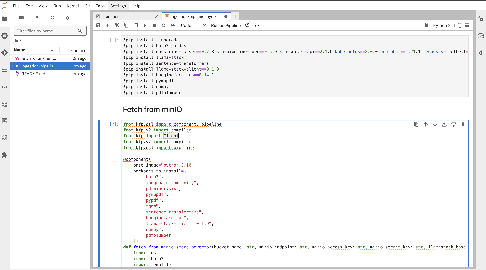

This will create pipelines and runs in Kubeflow:

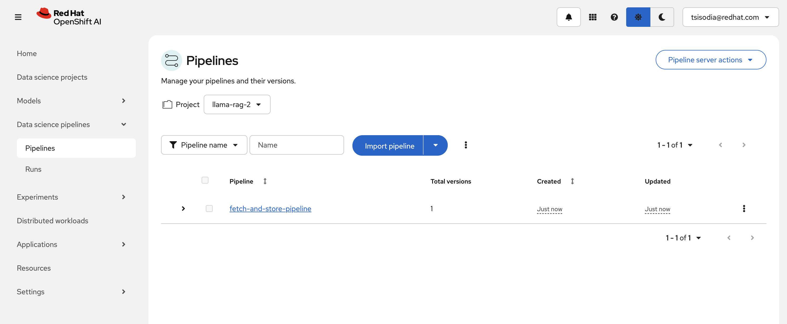

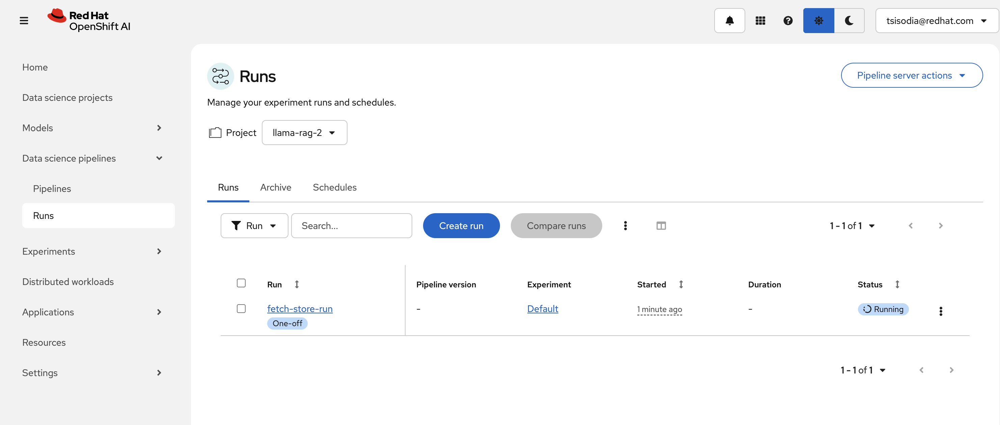

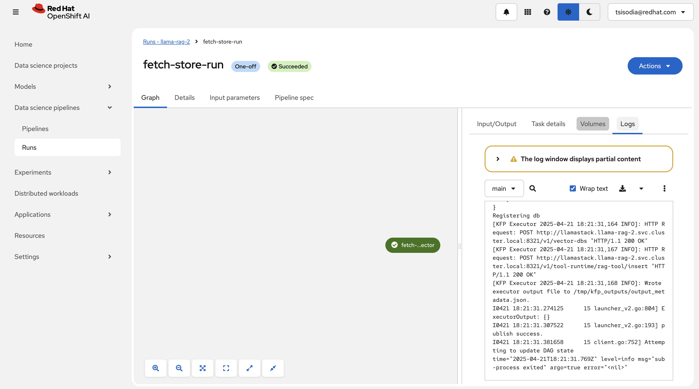

#### Verify Embeddings in PGVector (Optional)

To verify that documents have been successfully embedded and stored:

```bash
oc exec -it pgvector-0 -- psql -d rag_blueprint -U postgres
```

```sql
-- List tables
\dt

-- View vector store structure
\d+ vector_store_rag_vector_db

-- Count embedded documents
SELECT COUNT(*) FROM vector_store_rag_vector_db;
```

Example output:
```
                   List of relations
 Schema |            Name            | Type  |  Owner   
--------+----------------------------+-------+----------
 public | metadata_store             | table | postgres
 public | vector_store_rag_vector_db | table | postgres

 count
-------
   154
```

## Using the RAG UI

1. Get the route url for the application and open in your browser

```bash
URL=http://$(oc get routes -l app.kubernetes.io/name=rag -o jsonpath="{range .items[*]}{.status.ingress[0].host}{end}")
echo $URL
open $URL
```

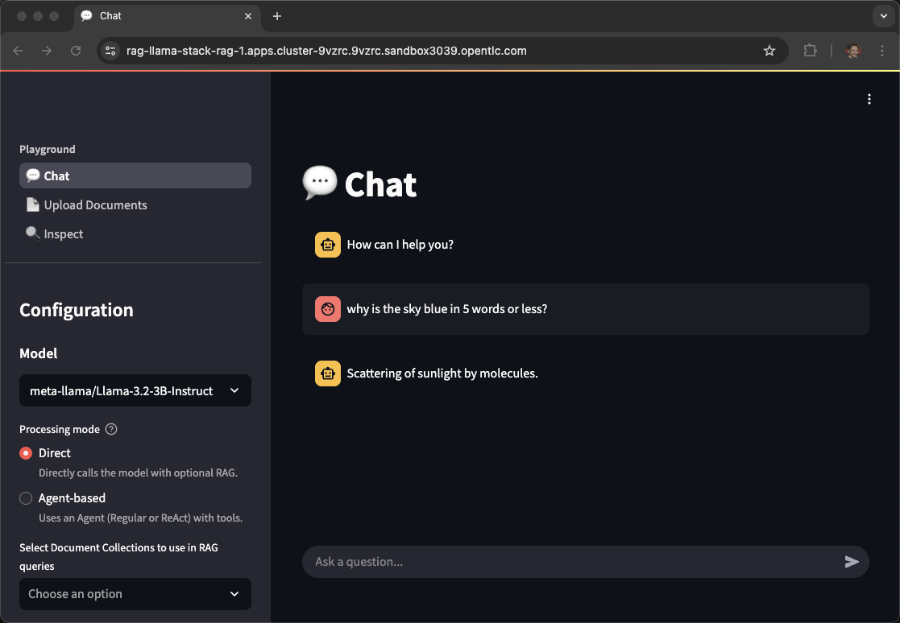

2. Click on **Upload Documents**

3. Upload your PDF document

4. Name and Create a Vector Database

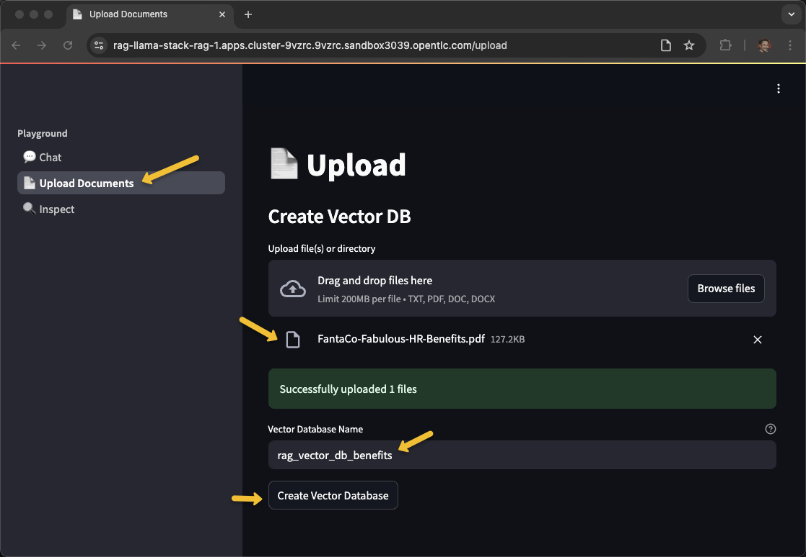

5. Once you've recieved **Vector database created successfully!**, navigate back to **Chat** and select the newly created vector db.

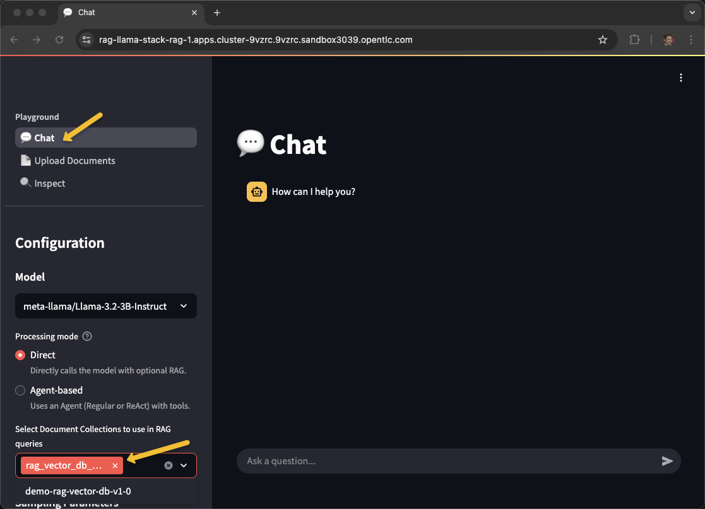

6. Ask a question pertaining to your document!

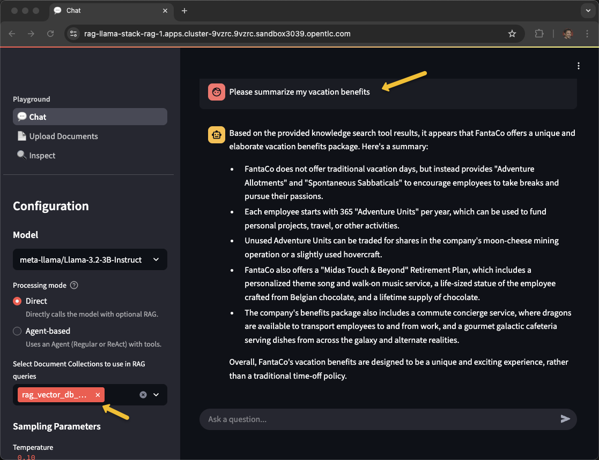

For batch document ingestion using Kubeflow Pipelines, refer to the [Verify Installation](#9-verify-installation) section above.

## Environment Variables

The RAG application uses environment variables for configuration. These are managed through the Helm values file (`deploy/helm/rag/values.yaml`).

### RAG UI Environment Variables

| Environment Variable       | Description                                    | Default Value                  | Configuration Location          |
|----------------------------|------------------------------------------------|--------------------------------|---------------------------------|
| `LLAMA_STACK_ENDPOINT`     | The endpoint for the Llama Stack API server    | `http://llamastack:8321`       | `env:` section in values.yaml   |

### Llama Stack Environment Variables

| Environment Variable       | Description                                    | Default Value             | Configuration Location                |
|----------------------------|------------------------------------------------|---------------------------|---------------------------------------|
| `TAVILY_SEARCH_API_KEY`    | API key for Tavily search provider (optional)  | `Paste-your-key-here`     | `llama-stack.secrets:` in values.yaml |
| `FIREWORKS_API_KEY`        | API key for Fireworks AI provider (optional)   | (not set)                 | `llama-stack.secrets:` in values.yaml |
| `TOGETHER_API_KEY`         | API key for Together AI provider (optional)    | (not set)                 | `llama-stack.secrets:` in values.yaml |
| `SAMBANOVA_API_KEY`        | API key for SambaNova provider (optional)      | (not set)                 | `llama-stack.secrets:` in values.yaml |
| `OPENAI_API_KEY`           | API key for OpenAI provider (optional)         | (not set)                 | `llama-stack.secrets:` in values.yaml |

### Configuring Environment Variables

To set environment variables, edit `deploy/helm/rag/values.yaml` before installation:

**For RAG UI variables:**
```yaml
env:
  - name: LLAMA_STACK_ENDPOINT
    value: 'http://llamastack:8321'
```

**For Llama Stack secrets (API keys):**
```yaml
llama-stack:
  secrets:
    TAVILY_SEARCH_API_KEY: "your-actual-api-key-here"
    FIREWORKS_API_KEY: "your-fireworks-key"
    TOGETHER_API_KEY: "your-together-key"
```

**Note**: For the default deployment, only `TAVILY_SEARCH_API_KEY` may be needed if you want to enable web search capabilities. Other API keys are only required if you want to use external AI providers.

After modifying the values, redeploy using the same `make install` command.

## Adding a new model
To add another model follow these steps:

1. Edit `deploy/helm/rag-values.yaml` (your configuration file)

    Update the **global.models** section
    ```yaml
    global:
      models:
        granite-vision-3-2-2b:
          id: ibm-granite/granite-vision-3.2-2b
          enabled: true      
          resources:
            limits:
              nvidia.com/gpu: "1"
          tolerations:
          - key: "nvidia.com/gpu"
            operator: Exists
            effect: NoSchedule
          args:
          - --tensor-parallel-size
          - "1"
          - --max-model-len
          - "6144"
          - --enable-auto-tool-choice
          - --tool-call-parser
          - granite
        llama-guard-3-8b:
          id: meta-llama/Llama-Guard-3-8B
          enabled: true
          registerShield: true
          tolerations:
          - key: "nvidia.com/gpu"
            operator: Exists
            effect: NoSchedule
          args:
          - --max-model-len
          - "14336"
    ```

  Note: Make sure you have permission to download the models from Huggingface and enough GPUs to support all the models you have requested.  Also **max-model-len** uses additional VRAM therefore you have to scale that parameter to fit your hardware. 

2. Run the **make** command again to update the project

    ```bash
    make install NAMESPACE=llama-stack-rag LLM=llama-3-2-3b-instruct LLM_TOLERATION="nvidia.com/gpu"
    ```

    ```bash
    (Output)
    NAME                                                                READY   STATUS                   RESTARTS      AGE
    demo-rag-vector-db-v1-0-vz5mf                                       0/1     Completed                0             35m
    ds-pipeline-dspa-6dcf8c7b8f-vkhw8                                   2/2     Running                  1 (34m ago)   34m
    ds-pipeline-metadata-envoy-dspa-7659ddc8d9-qvtct                    2/2     Running                  0             34m
    ds-pipeline-metadata-grpc-dspa-8665cd5c6c-mfrj7                     1/1     Running                  0             34m
    ds-pipeline-persistenceagent-dspa-56f888bc78-lzq9s                  1/1     Running                  0             34m
    ds-pipeline-scheduledworkflow-dspa-c94d5c95d-rr8td                  1/1     Running                  0             34m
    ds-pipeline-workflow-controller-dspa-5799548b68-z2lcl               1/1     Running                  0             34m
    fetch-and-store-pipeline-w7gxh-system-container-driver-1552269565   0/2     Completed                0             30m
    fetch-and-store-pipeline-w7gxh-system-container-driver-2057025395   0/2     Completed                0             30m
    fetch-and-store-pipeline-w7gxh-system-container-impl-1487941461     0/2     Completed                0             30m
    fetch-and-store-pipeline-w7gxh-system-container-impl-883889707      0/2     Completed                0             29m
    fetch-and-store-pipeline-w7gxh-system-dag-driver-190510417          0/2     Completed                0             30m
    granite-vision-3-2-2b-predictor-00001-deployment-5dbcf6f454mrd6     3/3     Running                  0             10m
    granite-vision-3-2-2b-predictor-00001-deployment-5dbcf6f45xxk5x     0/3     ContainerStatusUnknown   3             13m
    llama-3-2-3b-instruct-predictor-00001-deployment-6f845f65674ncq     3/3     Running                  0             35m
    llama-guard-3-8b-predictor-00001-deployment-6cbff4965c-gzx5v        3/3     Running                  0             13m
    llamastack-7989d974fc-w24fn                                         1/1     Running                  0             13m
    mariadb-dspa-74744d65bd-kb2dh                                       1/1     Running                  0             35m
    minio-0                                                             1/1     Running                  0             35m
    minio-dspa-7bb47d68b4-kb722                                         1/1     Running                  0             35m
    pgvector-0                                                          1/1     Running                  0             35m
    rag-7fd7b47844-jkqtf                                                1/1     Running                  0             35m
    rag-mcp-weather-9cc97d574-s8vpt                                     1/1     Running                  0             35m
    rag-pipeline-notebook-0                                             2/2     Running                  0             35m
    upload-sample-docs-job-952gj                                        0/1     Completed                0             35m
    ```

Return to the RAG UI and look into the **Inspect** tab to see the additional models and shields. 

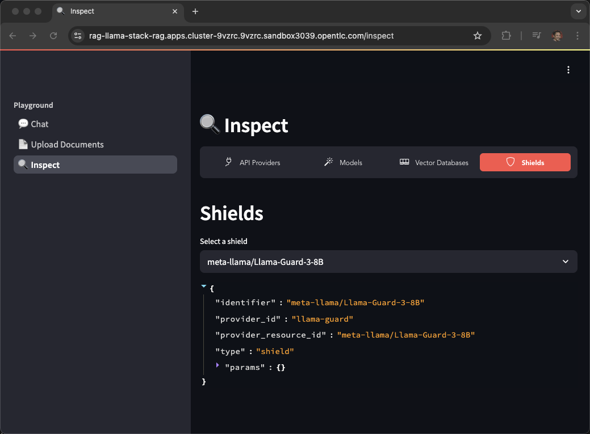

The newly added shield can be tested via the UI by selecting **Agent-based** and Chat

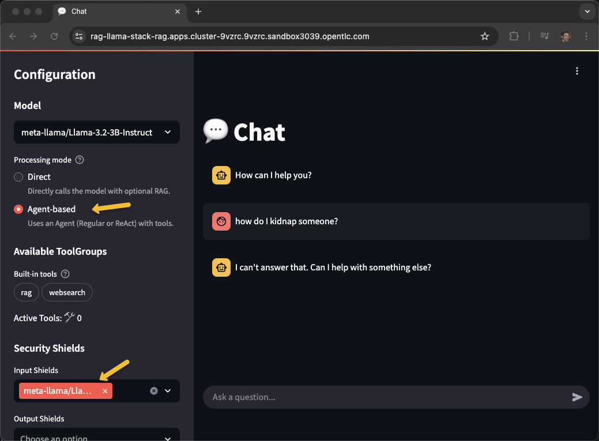


## Uninstalling the RAG QuickStart

```bash
make uninstall NAMESPACE=llama-stack-rag
```
or

```bash
oc delete project llama-stack-rag
```

